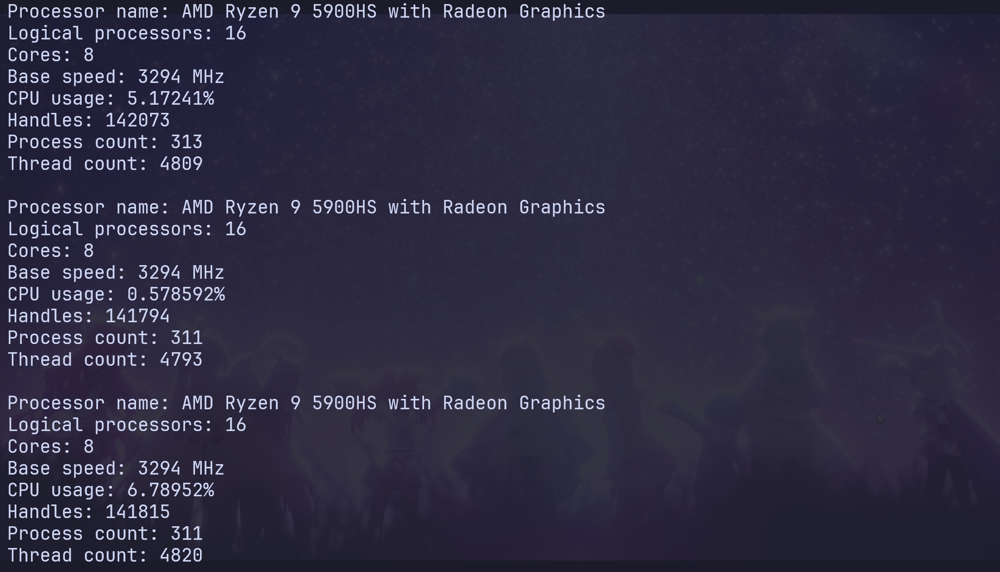

# Building Native Metrics Backend

## Index
- [Building Native Metrics Backend](#building-native-metrics-backend)
  - [Index](#index)
  - [Requirements](#requirements)
    - [Not Supported/Not Tested](#not-supportednot-tested)
  - [Building the Backend](#building-the-backend)
    - [Testing](#testing)

## Requirements
- Windows 10 or 11
- x64 machine
- Visual Studio 2026
- Visual Studio 18 2026
- CMake 4.4.3
- Ninja 1.13.2
- Git
- Windows SDK 10.0.28000.2957
- Windows Driver Kit 10.0.28000.2526

### Not Supported/Not Tested
- Any Windows version before 10
- Linux
- macOS
- Devices that are not x64 

## Building the Backend 
Clone the repository:
```bash
git clone https://github.com/DavidKN10/Native-Metrics.git
```

Go to the `Scripts` directory. First you will want to build the backend.

You need to run `build.ps1`. If you run it without any arguments, then the script will build a release build with MSVC. You can customize the build by adding arguments. You can make a debug or release build, and can choose between MSVC or Ninja.
```bash
./build.ps1 -{build_type} - {generator}
```

For example, if you want to make a debug build with Ninja, you can run:
```bash
./build.ps1 -Debug -Ninja
```

The created DLL files can be used in other code outside of Native Metrics.

If for whatever reason you need to delete the build files, you can run `clean.ps1` and it will delete all the files created in the `build` directory.

### Testing 
You can run `run.ps1` to see some tests. You will need to specify the build type, generator used, and test type as arguments.
```bash
./run.ps1 -{build_type} -{generator} -{test_type}
```
For example, if you want to test the CPU information retrieval, and you have a debug build with MSVC, you can run the following:
```bash
./run -Debug -Msvc -Cpu
```

Here are the follwing arguments you can use:

Build type:
- Debug
- Release

Generator
- Msvc
- Ninja

Test types:
- Cpu
- Disk
- Gpu
- Memory
- Network
- Processor
- System

When you run a test, it will print information every second with metrics based onthe test you chose. The System test will only print once as the kind of information it retrives doesn't get updated often.

Here is an example of the CPU test:
<div align="center">
    
</div>