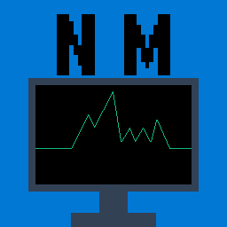
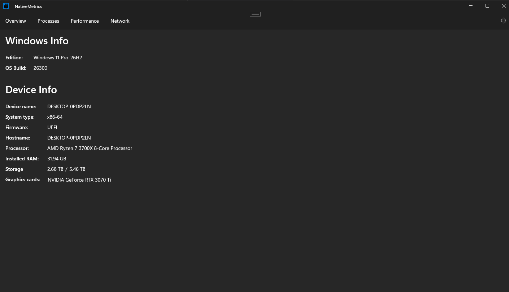
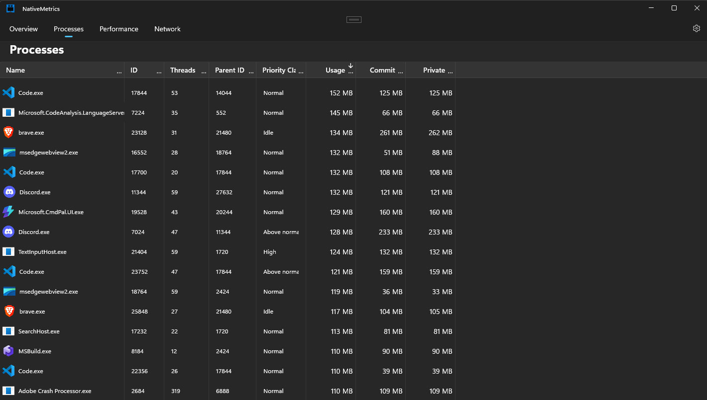
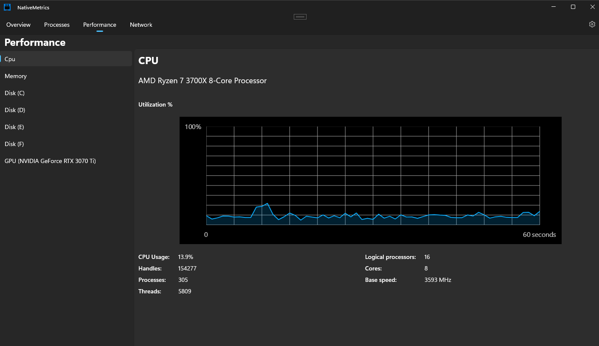

# Native Metrics

  

System monitoring application for Windows. Built with WinUI 3 with a native C++ backend.

## Index
- [Native Metrics](#native-metrics)
  - [Index](#index)
  - [Screenshots](#screenshots)
  - [Features](#features)
  - [Overview](#overview)
  - [System Requirements](#system-requirements)
  - [Quick Install](#quick-install)
  - [Quick Build](#quick-build)
  - [Documentation](#documentation)
  - [License](#license)

## Screenshots

## Features

## Overview

## System Requirements

## Quick Install

## Quick Build

## Documentation

## License
Native Metrics is licensed under MIT license. See [LICENSE](https://github.com/DavidKN10/Native-Metrics/blob/main/LICENSE) for more information.