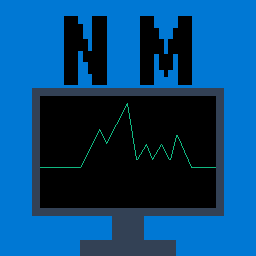
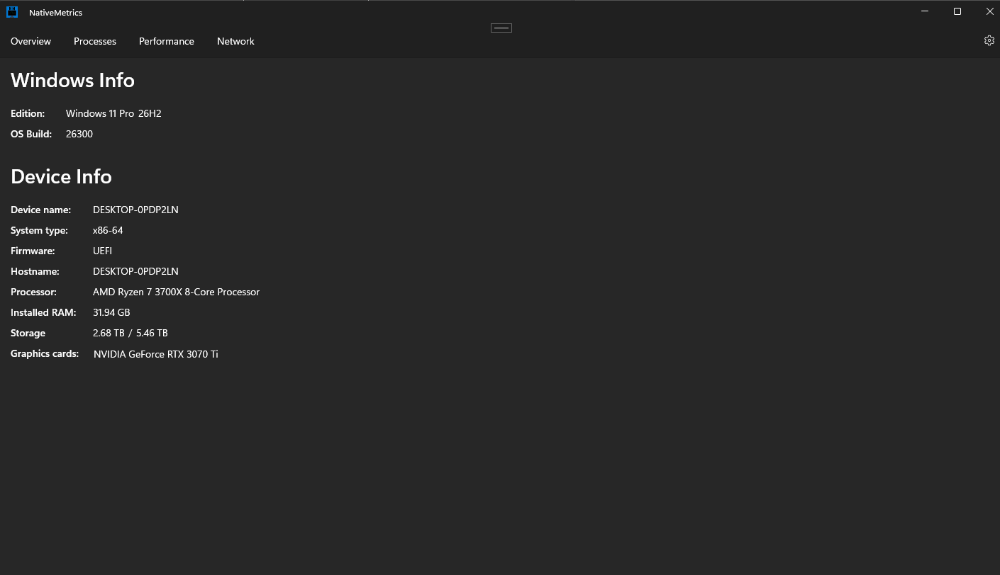
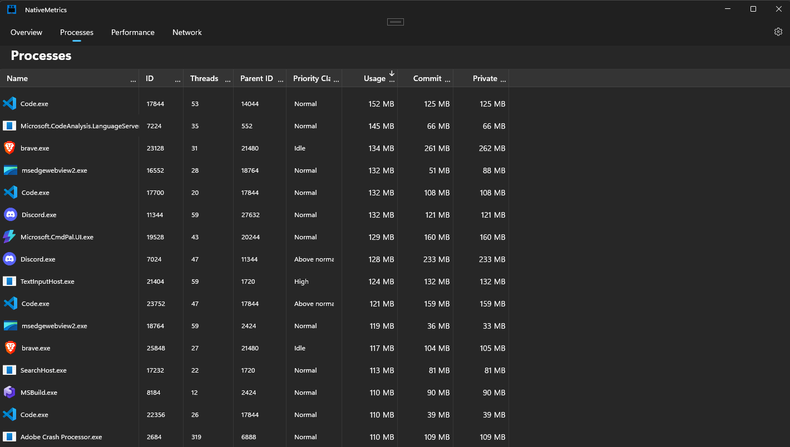
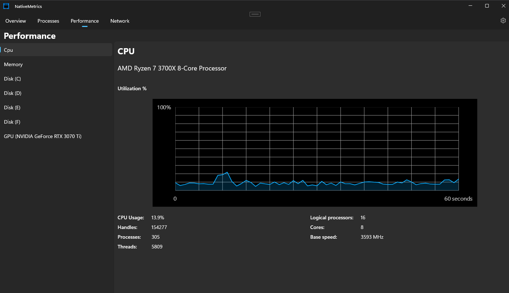

# Native Metrics

<div align=center>
  
</div>

System monitoring application for Windows. Built with WinUI 3 with a native C++ backend.

## Index
- [Native Metrics](#native-metrics)
  - [Index](#index)
  - [Screenshots](#screenshots)
  - [Features](#features)
  - [System Requirements](#system-requirements)
    - [Installation Requirements:](#installation-requirements)
    - [Build Requirements:](#build-requirements)
    - [Not Supported/Not Tested](#not-supportednot-tested)
  - [Quick Install](#quick-install)
  - [Quick Build](#quick-build)
    - [Build Library](#build-library)
    - [Building the App](#building-the-app)
  - [Documentation](#documentation)
  - [License](#license)


## Screenshots




## Features

With Native Metrics, you can view the following information:
- System overview like operating system and hardware information.
- View every running process and see data like process ID, memory usage, commit size, and private memory.
- Performance page that contains metrics about a deivce's CPU, memory, disks, and graphics cards. These metrics update at every time interval.
- Each page contains a live graph displaying one metric:
    - CPU page displays CPU usage percentage.
    - Memory page displays memory usage percentage.
    - Disk pages display a graph for active time and another for transfer rate.

**Note:** GPU page has limited implementation as I programmed the backend to use DXGI and DXCore which provide limited information about a graphics card.

## System Requirements
### Installation Requirements:
- Windows 10 or 11
- x64 processor

**Recommended:**
- Windows 11
- Latest Windows update
- 1920x1080 display

### Build Requirements:
- Visual Studio 2026
- Visual Studio 18 2026
- CMake 4.4.3
- Ninja 1.13.2
- Git
- Windows SDK 10.0.28000.2957
- Windows Driver Kit 10.0.28000.2526

### Not Supported/Not Tested
- Windows 7
- Windows 8/8.1
- Linux
- macOS
- 32-bit Windows

## Quick Install
Check the releases page and download the msix installer. Then open the installer to install the application. 

## Quick Build
Clone the repository:

```bash
git clone https://github.com/DavidKN10/Native-Metrics.git
```

### Build Library

First you need to build the C++ library. In order to do that, you need to run `build.ps1` in the `Scripts` folder. This will use the default options and make a release build using MSVC.

You can add arguments to specify what kind of build you want.

```bash
./build.ps1 -{build_type} -{generator}
```

For example, if you want to make a debug build with Ninja, you can add the folowing arguments:
```bash
./build.ps1 -Debug -Ninja
```

If you want more information on building the C++ library, check [NativeMetrics_core/docs/BUILD](https://github.com/DavidKN10/Native-Metrics/blob/main/NativeMetrics_core/docs/BUILD.md)

### Building the App
The C++ library can be used outside this application, but in order for the app to use it, you need to create a release build with MSVC.

In the `NativeMetrics` folder, open `NativeMetrics.slnx` with Visual Studio. When you click on run, the app should start working.

If you want more information about building the frontend, go to [docs/BUILD](https://github.com/DavidKN10/Native-Metrics/blob/main/docs/BUILD.md) to learn more. 

## Documentation
See [docs](https://github.com/DavidKN10/Native-Metrics/tree/main/docs) for more documentation on the frontend.

See [Nativemetrics_core/docs](https://github.com/DavidKN10/Native-Metrics/tree/main/NativeMetrics_core/docs) for more documentation on the backend.

## License
Native Metrics is licensed under MIT license. See [LICENSE](https://github.com/DavidKN10/Native-Metrics/blob/main/LICENSE) for more information.